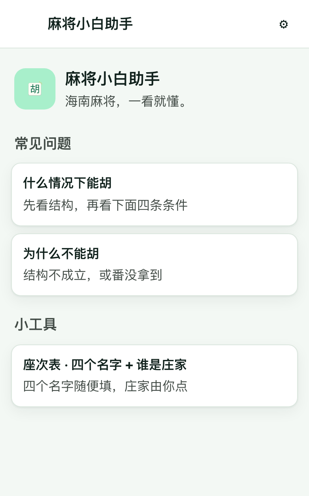
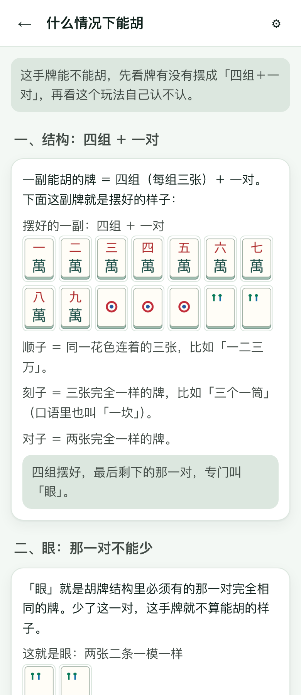
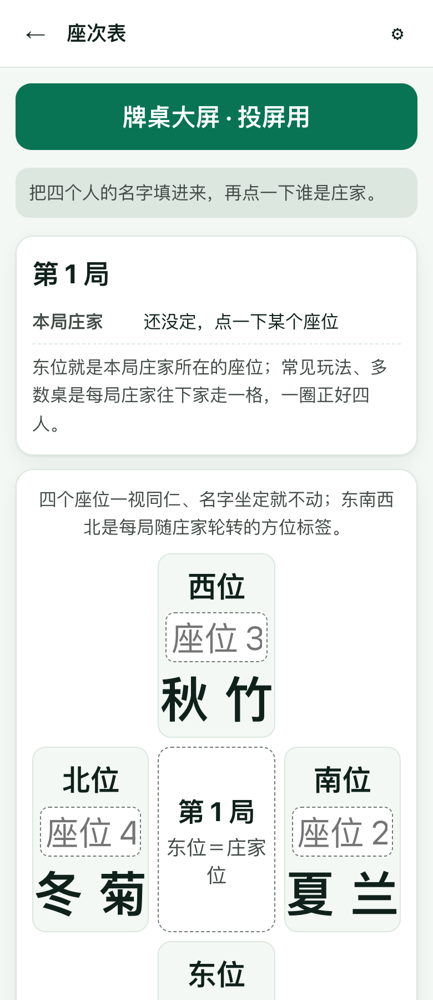

# Mahjong Quick Guide 麻将小白助手

> Hainan mahjong's "when can I win" rules, broken into tile diagrams a complete beginner can follow at the table.

[简体中文](README.md) | English

<p>
  
  
  
</p>

## What problem it solves

At your first table, a rulebook's "four groups and a pair", "eye", "fan", "win off a discard" and "self-draw" are all new words; after one explanation, they are gone again by the time you get home.

This tool covers Hainan mahjong only and is not an encyclopedia of scoring patterns. It answers what actually blocks you before a game: when this hand can win, why it cannot, and what people mean by sequence, triplet, pung, chow, kong, ready hand and flower tile. Every rule comes with real tile faces, and each term is explained in plain language where it first appears.

## Core capabilities

- **When can I win**: one page covering the winning shape (four groups + one pair), what the "eye" is, what "fan" does, and the four conditions common in Hainan play — the eye is a 2/5/8, your seat matches its flowers, your seat's wind forms a triplet, and with fan you may win off a discard while without fan you can only self-draw; each condition is shown with tiles.
- **Why can't I win**: concrete hands explain what is missing, from the difference between 13 and 14 tiles to an invalid shape and unmet conditions.
- **8 reviewed hands**: E01–E07 and E16, each with a can-win / cannot-win verdict, the reason, what is missing and the next step; flower tiles are shown separately, never mixed into the hand.
- **Glossary**: 13 entries for sequence, triplet, pung, chow, kong, ready hand, flower tile, missing suit, eye, fan, seats and seat-to-flower mapping, each with real tile faces.
- **Seat table**: enter four names, tap who is dealer, and see how east/south/west/north rotate each round; names, dealer, round and rotation direction are saved on the device.
- **Table screen**: opened from the seat table, it shows the round, dealer and four seats large enough for the whole table to read.
- **Chinese and English**: language can follow the system, falling back to Simplified Chinese when the system language is unsupported.
- **Light / dark / follow system**: appearance can be switched and remembered without losing the current page.
- **Installable and offline**: ships `manifest.webmanifest` and a Service Worker (current cache version `p046-v8`); once added to a phone's home screen it opens like an app and works offline.

## Quick start

Online (recommended; opens directly on a phone):

<https://wanghoufan.github.io/p046-mahjong-beginner-assistant/>

Use the browser's "Add to Home Screen" on a phone to open it like an app afterwards.

Run locally:

```bash
cd prototype
python3 -m http.server 8080
```

Then open <http://localhost:8080/>. You can also double-click `prototype/index.html` and open it over `file://`; the content still works, but offline caching and home-screen installation only work over `http(s)`.

The project is a plain static site with no framework, no build step and no npm dependencies; `prototype/` itself is the complete deployable site.

## Data and privacy

- Rules, hands, terms and copy are static files inside the repository; the page makes no network requests at runtime (and does not rely on fetch/XHR under `file://`).
- There are no accounts, logins, analytics or reporting; theme, language and seat-table content live only in the current browser's `localStorage` (keys `p046.theme`, `p046.lang`, `p046.seat`).
- Rule sources and their evidence grades are listed on the in-page "About" screen for you to check.
- The offline cache stores same-origin static assets only and caches no cross-origin content.

## Known limitations

- Covers **Hainan mahjong** only; other regional variants are not included in this version.
- **Not a hand evaluator**: it does not judge arbitrary hands in real time; it presents only the 8 reviewed static examples.
- Tables in Hainan may play differently, so the page's wording defers to your table; rules with insufficient evidence, such as "a flower tile also serving as the eye", are not presented as decidable rules.
- The product contains no betting, scoring or gambling features.
- Tile faces are PNG images and blur at very high zoom.
- The table screen only displays, sets the dealer and advances a round; it has no name input or direction setting — those happen in the seat table.
- The repository provides no automated test scripts; existing acceptance records are under `docs/qa/`.
- The UI is available in Simplified Chinese and English only.
