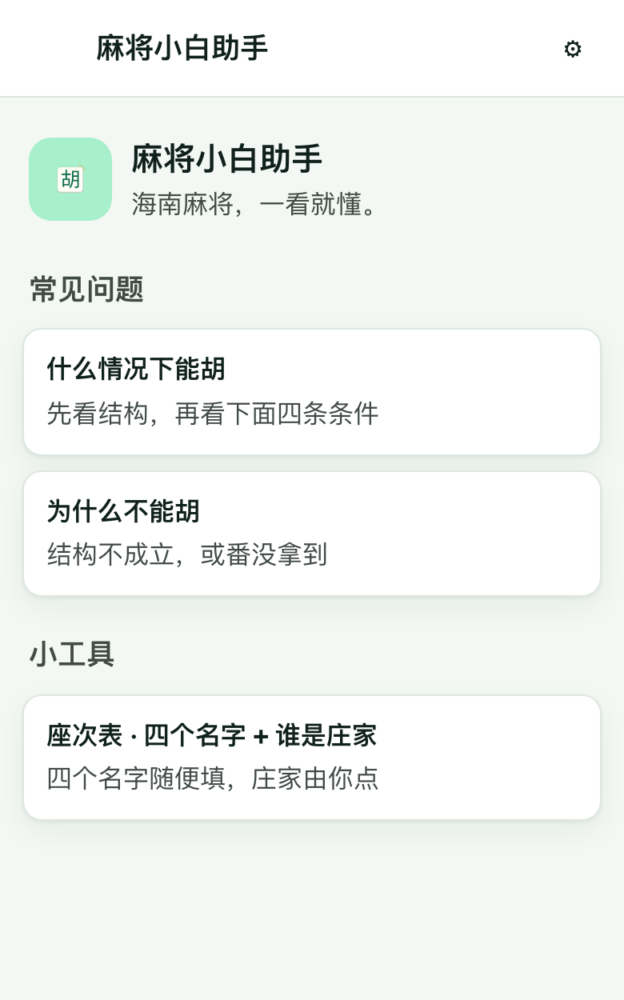
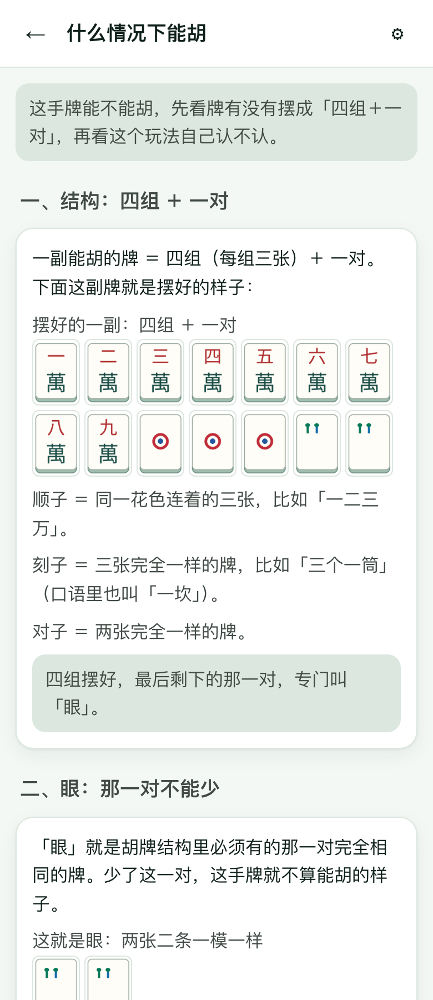
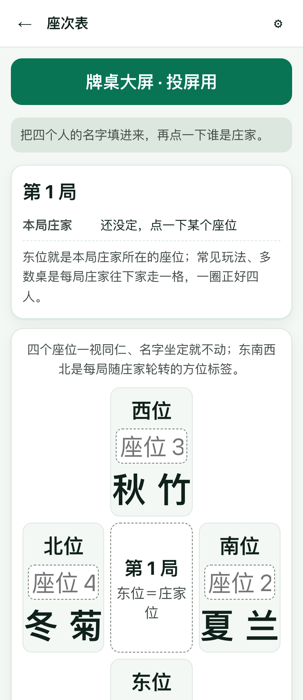

# 麻将小白助手

> 把海南麻将「什么情况下能胡」拆成看得懂的牌面图，完全不懂麻将的人也能照着上桌。

[English](README.en.md)

<p>
  
  
  
</p>

## 它解决什么问题

第一次上桌，规则书里的「四组一对」「眼」「番」「点炮」「自摸」全是生词；听人讲一遍，回家又忘了。

这个工具只讲海南麻将，不做番种大全，只回答上桌前真正会卡住的几件事：这手牌什么情况下能胡、为什么不能胡、别人说的顺子 / 刻子 / 碰 / 吃 / 杠 / 听牌 / 花牌到底是什么。每条规则都配真实牌面，术语第一次出现时就地用大白话解释。

## 核心能力

- **什么情况下能胡**：一页讲清胡牌结构（四组 + 一对）、「眼」是什么、「番」有什么用，以及海南玩法常见的四条条件——眼是二 / 五 / 八、座位对花、座位对应风牌凑三张、有番可点炮胡而无番只能自摸；每条都配牌面。
- **为什么不能胡**：按具体牌例讲清差在哪里，从 13 张与 14 张的区别，到结构不成立、条件没满足。
- **8 条真实牌例**：E01–E07、E16，每条给出能胡 / 不能胡的结论、原因、差什么和下一步；花牌单独摆出，不混进手牌。
- **术语表**：顺子、刻子、碰、吃、杠、听牌、花牌、缺门、眼、番、座次与花牌对应等，共 13 个词条，每个都有真实牌面对照。
- **座次表**：填四个人的名字、点一下谁是庄家，逐局算出东南西北怎么轮转；名字、庄家、局数与轮转方向都会保存在本机。
- **牌桌大屏**：从座次表进入，把局数、庄家和四个方位投到大屏上，供一桌人一起看。
- **中英双语**：可跟随系统，系统语言不受支持时回退简体中文。
- **浅色 / 深色 / 跟随系统**：外观可切换并记住，切换不会丢掉当前页面。
- **可安装、可离线**：带 `manifest.webmanifest` 与 Service Worker（当前缓存版本 `p046-v8`），添加到手机主屏幕后可像 App 一样打开，断网也能看。

## 快速开始

线上版（推荐，手机可直接打开）：

<https://wanghoufan.github.io/p046-mahjong-beginner-assistant/>

手机浏览器打开后可用「添加到主屏幕」，之后像 App 一样使用。

本地运行：

```bash
cd prototype
python3 -m http.server 8080
```

然后打开 <http://localhost:8080/>。也可以直接双击 `prototype/index.html` 用 `file://` 打开，页面内容照样能看；只是「离线缓存、安装到桌面」这类能力需要 `http(s)` 环境才会生效。

项目是纯静态站点，没有框架、没有构建步骤、没有 npm 依赖；`prototype/` 目录本身就是可部署的完整站点。

## 数据与隐私

- 规则、牌例、术语和文案都在仓库内的静态文件中，页面运行时不发网络请求（`file://` 下也不依赖 fetch/XHR）。
- 没有账号、登录、统计或上报；主题、语言和座次表内容只存在当前浏览器的 `localStorage`（键名 `p046.theme`、`p046.lang`、`p046.seat`）。
- 规则来源与证据等级在页面内「关于」中列出，可自行核对。
- 离线缓存只保存同源静态资源，不缓存跨域内容。

## 已知限制

- 只覆盖**海南麻将**这一档，其它地区玩法本版本不收录。
- **不是判牌引擎**：不会对任意手牌做实时胡牌判断，只呈现 8 条已审核的静态牌例。
- 海南各桌规矩可能不同，页面里的说法以你们那桌为准；「当花又当眼」这类证据不足的规则没有写成可判定规则。
- 产品不含任何下注、计分或赌博功能。
- 牌面图为 PNG，放大倍率过高会发虚。
- 牌桌大屏只做展示、点庄家和「下一局」，不提供名字输入或方向设置；这些操作在座次表里完成。
- 仓库内未提供自动化测试脚本；现有验收记录在 `docs/qa/` 中。
- 界面只提供简体中文与英文两种语言。
