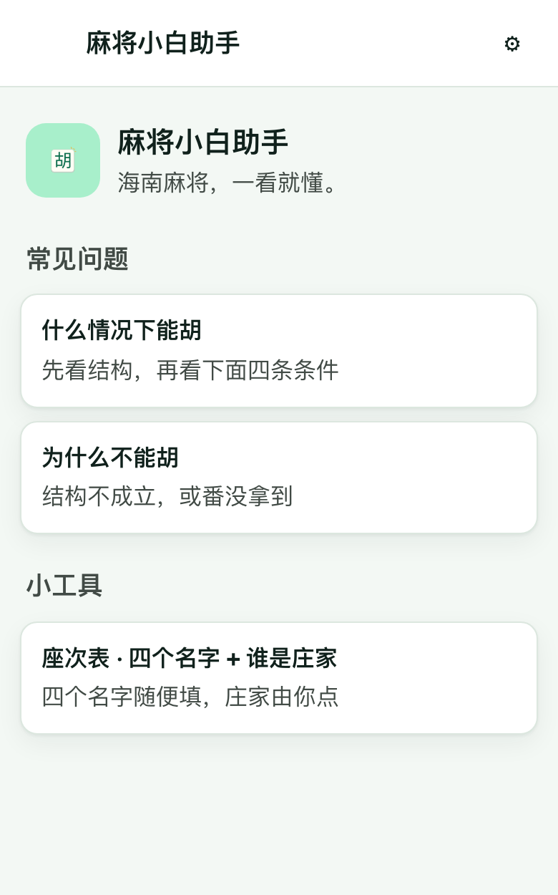
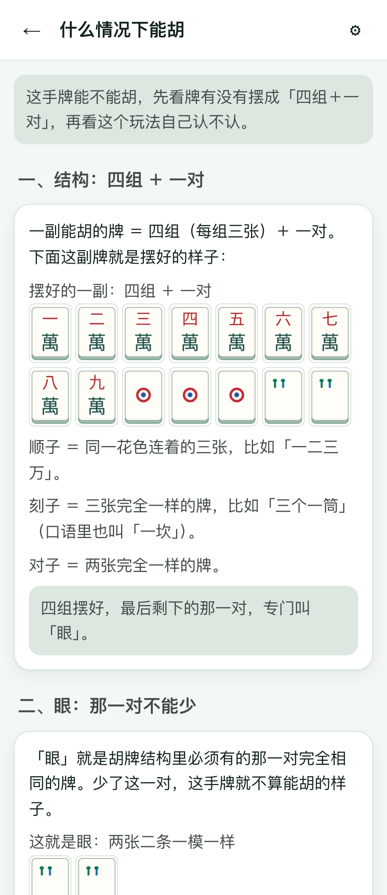
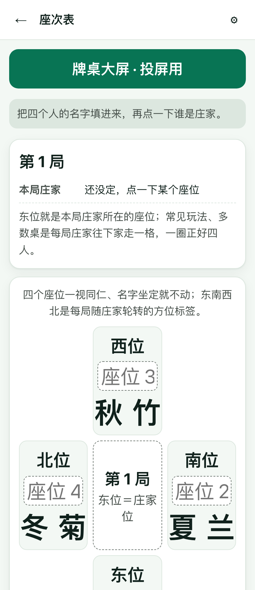

# 麻将小白助手

[English](./README.en.md)

第一次上桌打海南麻将之前，先把「什么情况下能胡」看明白——规则全部配真实牌面，不懂麻将也能照着上手。

<p align="center">
  
  
  
</p>

## 这是什么

一个讲**海南麻将**的规则速查教学工具，专门给完全不懂麻将规则的人用。

它不做「番种大全」，只回答上桌前真正会卡住的几件事：

- 这手牌**什么情况下能胡**？
- 手上这副牌**为什么不能胡**？
- 别人说的**顺子、刻子、碰、吃、杠、听牌、花牌**到底是什么？

每条规则都配**真实牌面图**，术语第一次出现时就地解释，不留没解释的专业词。

## 能做什么

| 功能 | 说明 |
|---|---|
| 什么情况下能胡 | 一页讲透：胡牌结构（四组＋一对）、「眼」是什么、「番」有什么用，以及海南玩法的四条条件——眼是二/五/八、座位对花、风牌箭牌凑三张、有番能点炮没番只能自摸，每条都配牌面 |
| 为什么不能胡 | 按具体牌例讲清差在哪里：从 13 张与 14 张的区别，讲到结构不成立、条件没满足 |
| 8 条真实牌例 | 每条给出能胡／不能胡的结论、原因、差什么、下一步；花牌单独摆出，不混进手牌 |
| 术语表 | 顺子、刻子、碰、吃、杠、听牌、花牌、缺门……每个术语都有真实牌面对照 |
| 座次表（小工具） | 填四个人的名字、点一下谁是庄家，就能逐局算出东南西北怎么轮转 |
| 牌桌大屏（小工具） | 把座次与风向投到大屏上，一桌四个人都能看见 |

另外还有：

- **中英双语**，语言可跟随系统；系统语言不支持时回退简体中文。
- **浅色 / 深色 / 跟随系统** 三种外观，切换不会丢掉当前正在看的页面。
- **可安装、可离线**：添加到手机主屏幕后像 App 一样打开，断网也照常看。
- **零依赖、零联网**：纯静态页面，没有框架也没有构建步骤，双击 `index.html` 就能打开。

## 怎么用

### 方式一：直接打开线上版（推荐，手机也能用）

<https://wanghoufan.github.io/p046-mahjong-beginner-assistant/>

国内网络下这个地址比 `*.vercel.app` 更容易打开；Vercel 镜像保留在 <https://p046-mahjong-guide.vercel.app/index.html>。

手机上打开后可以「添加到主屏幕」，之后像 App 一样用，断网也能看。

### 方式二：在本地跑起来

```bash
cd prototype
python3 -m http.server 8080
# 然后浏览器打开 http://localhost:8080/
```

也可以直接双击 `prototype/index.html`（`file://` 方式打开），页面内容照样能看；只是「离线缓存、安装到桌面」这类能力需要 `http(s)` 环境才会生效。

## 覆盖范围与限制

- 玩法只覆盖**海南麻将**这一档，其它地区玩法本版本不收录。
- **不是判牌引擎**：不会对任意手牌做实时胡牌判断，只呈现 8 条已审核的静态牌例（E01–E07、E16）。
- 规则来自公开资料与本地玩法整理，各桌规矩可能不同，**以你们那桌为准**；来源与证据等级可在页面内「关于」中查看。
- 产品不含任何下注、计分或赌博功能。
- 牌面图为 PNG，放大倍率过高会发虚。

## 技术说明

- 纯静态：`index.html` + `app.js` + `app.css` + `i18n.js` + `data/*.js`，无框架、无构建、无外链。
- 数据双份：`data/rules.js`、`data/examples.js` 是运行期真源，`data/*.json` 是规范记录源；改数据必须同步两处并保持两份 JSON 等价。
- PWA：`manifest.webmanifest` + `sw.js`，`SW_VERSION` 控制缓存版本，新版本接管后页面会自动刷新。
- 部署：`prototype/` 本身就是完整静态站点，可放到任意静态托管（本项目用 Vercel）。

## 目录

| 目录 | 内容 |
|---|---|
| `prototype/` | 产品本体：可运行、可安装、可离线的静态站点 |
| `docs/pm/` | 产品计划、体验契约、设计冻结草案 |
| `docs/qa/` | 产品验收追踪矩阵 |
| `docs/plan/` | 项目交接包与品牌资产 |
| `docs/handoff/` | 项目状态与交接记录 |

> 仓库根目录的 `AGENTS.md`、`docs/roles/`、`docs/sop/` 等是开发过程中的协作与治理约定，与产品使用无关，可以忽略。
